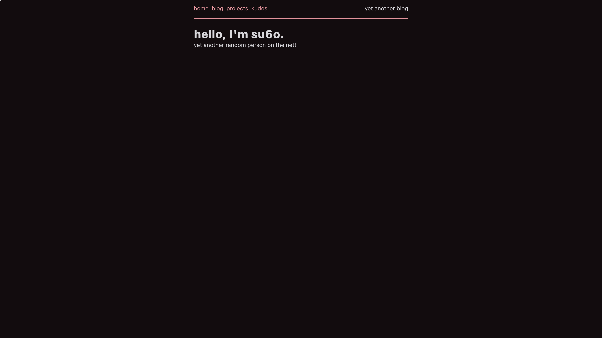
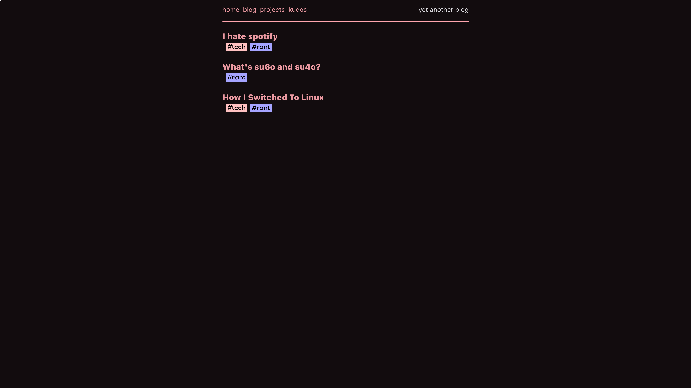
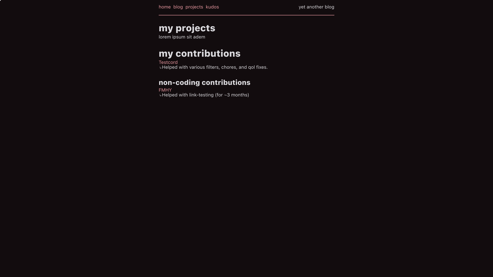
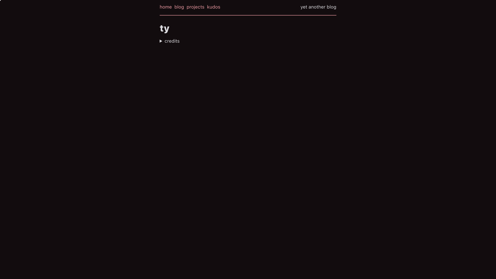

# blog
yet another blog on the net

---

## Sections

- Home (`/`): just a landing page.
- Blog: stories I write up from time to time.
- Projects: Showcase of personal projects (w.i.p) & contributions to projects.
- Kudos: credits to various sites and projects that helped me build the site.

## tech stack
- html5
- css3
- Vanilla JS

## how it was made & problems solved

I didn't know how to use all these complex libraries like GSAP, but I wanted to make a site that looked clean enough for me to just start typing my ideas out.

- challenge: avoiding heavy configuration and coding but still get a clean site.
- solution: make a clean static template structure (`.template`) that makes adding & formatting new posts pretty straightforward

## Screenshots
<details> 
   <summary></summary>
      
      
      
      
</details>

## demos & links

- live site: [read.wf.md](https://read.wf.md)
- repo: [github.com/Su6o/blog](https://github.com/Su6o/blog)


## running locally
because this is a static website, it's pretty easy to run it locally

1. clone the repository:
   ```bash
   git clone https://github.com/Su6o/blog.git
   cd blog
   ```

2. serve it locally using a static file server:
   ```bash
   python3 -m http.server 8000
   ```
   or open the folder in vscode and use the live server extension.

## ai disclosure

minimal AI was used. I used 2 JS scripts at the bottom for Tippy & fixing ScrollReveal.
<br>
you can see the AI code [at the bottom of any html](https://github.com/Su6o/blog/tree/main/main/written) in `written`.

## License

I don't know why you would, but you can fork the project and write your own blogs using the html file inside (`.template`)
